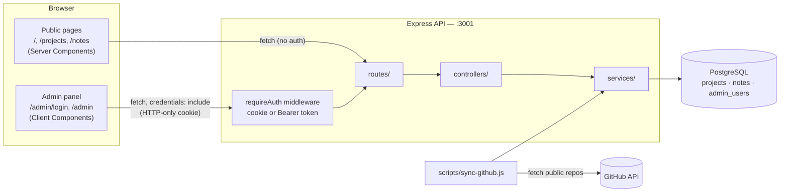

# Nik-Blog

**A portfolio and blog built as a real multi-layer application** — a REST API with authentication, a public site, and a private admin panel, instead of a static page. The goal isn't just "a portfolio," it's a genuine full-stack engineering demonstration: a backend and frontend talking over REST, real auth protecting a real admin surface, and (once built) a working embeddings-based search — nothing decorative, nothing claimed here that isn't actually running.

> Personal project, actively being built. See [`PLAN.md`](../nikan-career-assistant/projects-in-progress/nik-blog/PLAN.md) in the career-assistant repo for the full phase-by-phase plan and a dated progress log of every decision made along the way.

---

## The idea

Most portfolio sites are a static page with a list of links. This one is built the way a real product would be: a database holds the content, an API serves it, a public site renders it, and an admin panel (behind real authentication) is how new content actually gets published — no hand-editing files, no rebuilding the site to add a project.

Three things this project is deliberately *not* doing, and why:

- **Not re-rendering GitHub's own pages.** A project's README and source stay on GitHub, linked directly — this site writes its own original notes instead of duplicating what GitHub already shows well.
- **Not using Kubernetes.** Already proven via a separate project ([LedgerLite](https://github.com/NikanEidi/ledgerlite)); for a low-traffic personal site it would be pure operational overhead with no new skill payoff.
- **Not inventing a custom note-writing format.** Notes are stored as plain Markdown — exactly how every note in this project already gets written by hand — and rendered client-side, instead of building a bespoke rich-text engine nobody needs.

## Architecture



Two independent services, talking only over REST — nothing shares code or a process:

```
backend/   Node.js + Express, PostgreSQL, JWT auth — routes → controllers → services
frontend/  Next.js (App Router) + TypeScript — Server Components for public pages,
           Client Components for the authenticated admin panel
```

Deployed separately once live: frontend on Vercel, backend + Postgres on Render/Railway.

## What's actually built and working right now

Nothing below is aspirational — everything here has been tested live, end to end.

**Auth** — single admin account (this is a one-person blog, not a multi-user platform). Password hashed with `bcrypt`, session is a JWT held in an **HTTP-only cookie** (not `localStorage`), so client-side JavaScript can never read it even if an XSS bug ever got introduced. `requireAuth` middleware accepts either that cookie (how the browser authenticates) or a `Bearer` header (how a non-browser client like `curl` authenticates).

**Projects** — public `GET /projects` / `GET /projects/:slug` (published only), admin-only create/update/delete. A `scripts/sync-github.js` job pulls every public, non-fork GitHub repo and upserts it: a never-before-seen repo comes in as a `draft` awaiting review; a repo that matches an existing row (by URL, or by slug if it was created by hand first) only gets its metadata refreshed — its `status` is never touched, so re-running the sync can never silently un-publish something already reviewed.

**Notes** — same public/admin split as Projects. Categories are real tech domains matched to the actual project mix (`ai-ml`, `backend`, `infrastructure`, `ios`, `dsa`) rather than a generic "general" bucket. Content is stored as plain Markdown and rendered client-side with `react-markdown`.

**Admin panel** — `/admin/login` (a real form, not a curl command) sets the auth cookie; `/admin` lists every project and note regardless of status, with a one-click publish/draft toggle backed by a lightweight `PATCH .../status` endpoint.

## What's deliberately not built yet

- **Visual design.** Every page above is functional but intentionally unstyled — logic and data flow first, one real design pass later (not per-page, to avoid redoing styling repeatedly as pages get added).
- **Admin forms to create/edit notes and projects** (the dashboard can currently only toggle status, not write new content yet).
- **Tag/topic system and note grouping** — notes currently have one category each; richer tagging (including pulling in a linked project's GitHub topics) is a planned follow-up.
- **Semantic search ("ask my notes")**, tests + CI, and deployment.

## Local development

**Requirements:** Node.js, Docker.

```bash
# start the database
docker compose up -d

# backend
cd backend
npm install
node index.js        # http://localhost:3001

# frontend (separate terminal)
cd frontend
npm install
npm run dev           # http://localhost:3000
```

## Learning notes

Every real piece of work gets a note under [`notes/`](notes/) — what was built, why it's built that way, and the syntax/logic explained, written from the actual build sessions rather than from theory. Start at [`notes/README.md`](notes/README.md).

**On AI usage:** this project is built collaboratively with Anthropic's Claude — pairing on code, and drafting the learning notes from real build sessions, which I review and correct. Project cover images are AI-generated (Google Gemini) from prompts I write myself to match the site's own design system.

## License

Not yet decided — will be added before this is made public.
